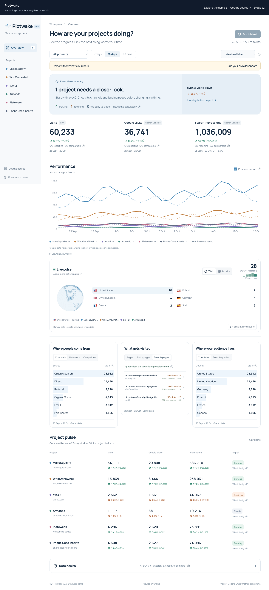
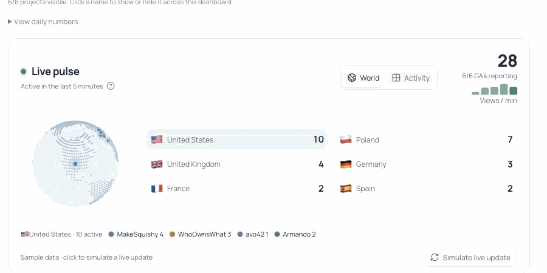

<p align="center"></p>
<h1 align="center">Plotwake</h1>
<p align="center"><strong>A morning check for everything you ship.</strong><br>GA4 and Google Search Console, across your web projects, on one screen.</p>
<p align="center"><a href="https://avo42.com/pulse/">Try the live demo</a> · <a href="#quick-start">Run it yourself</a> · <a href="docs/google-setup.md">Connect Google</a> · <a href="https://github.com/matt-warchol/plotwake/issues">Issues</a></p>
<p align="center"><a href="LICENSE"></a>  </p>

<p align="center"><a href="https://avo42.com/pulse/"></a></p>

<p align="center"><a href="https://avo42.com/pulse/"></a></p>

*Real project names, synthetic numbers. The animation and [public demo](https://avo42.com/pulse/) do not show actual project traffic.*

I kept shipping small websites, then opening a different Google property for each one just to see whether anything was happening. Plotwake is the screen I wanted to open in the morning: what is growing, what needs attention, and what is too early to judge.

This is the whole application. It runs on Node.js with a local SQLite database. No OpenAI account, Cloudflare account, paid analytics service or LLM key is needed. Your Google account still needs GA4/Search Console access, and the Google connection takes a one-time Apps Script setup.

## What you get

- **A daily briefing.** Source warnings and meaningful declines come first. Small samples and incomplete baselines stay explicit. The briefing is calculated by rules, not an AI model.
- **Three useful numbers.** Visits across all channels, Google web-search clicks and impressions. Compare 7, 28 or 90 days with the preceding period. Choose the latest available dates or exclude the last 3 days.
- **A live pulse below the main chart.** See active GA4 users from the last five minutes, a dotted country globe, and a project-by-project activity matrix. Tap a country or a minute to see the detail. It refreshes while visible; the public demo uses synthetic updates.
- **Several projects, one board.** Toggle project names in the chart legend to compare any subset. The same selection scopes KPIs, the briefing, every detail report and the project table. Open each source in Google from Data health.
- **Numbers with context.** Absolute changes before percentages. Missing history is not a measured zero. Overlapping Search Console scopes count once, including nested subdomains.
- **Graceful failures.** A failed Search Console request does not hide healthy GA4 visits. Existing reports remain available, with warnings and last-successful-fetch timestamps.
- **Traffic details.** Channels, referrers, campaigns, pages, entry pages, countries and Google search queries, with explicit units and date windows. Optional setup reminders can be hidden and restored.
- **Search page watch.** In *What gets visited*, switch to *Search pages* to spot URLs whose clicks fell by at least 3 and 10% while impressions stayed within 5% or grew. Expand a row for CTR and average position vs the previous period. The report uses Google's top 1,000 page rows per period, so it is a focused warning list rather than an exhaustive crawl.
- **A practical interface.** Mobile project cards, visible freshness, remembered view settings, separate settings drafts and Cancel.

## Try before connecting anything

[Open the public demo](https://avo42.com/pulse/). No login, Google connection or personal data is required. All figures are generated locally. The public build has no report backend and cannot read or save a live Google connection.

Or run the same static demo locally:

```sh
npm ci
npm run build:demo
npm run preview:demo
```

Open the URL printed by Vite. This is a synthetic demo, not your personal dashboard.

## Quick start

Requires **Node.js 24+**, npm, and a persistent writable disk. Docker is optional.

```sh
git clone https://github.com/matt-warchol/plotwake.git
cd plotwake
npm ci
cp .env.example .env
```

Generate a password:

```sh
openssl rand -base64 32
```

Put it in `.env` as `PLOTWAKE_PASSWORD`. The server refuses the example password and passwords shorter than 16 characters. Then:

```sh
npm run build
npm start
```

Open **http://localhost:3000**. Your browser asks for the username (`admin` unless changed) and password from `.env`. Open Connections, add your projects, then follow [Google setup](docs/google-setup.md).

This is a **single-owner dashboard**, not a multi-user SaaS. All authenticated requests use the same project board. Keep the password private. For remote access, put the server behind HTTPS; do not send Basic authentication credentials over plain HTTP.

### Configuration

| Variable | Default | Purpose |
|---|---|---|
| `PLOTWAKE_PASSWORD` | Required | Unique 16+ character dashboard password; kept on the server |
| `PLOTWAKE_USERNAME` | `admin` | Browser sign-in username |
| `APP_ORIGIN` | `http://localhost:3000` | Exact origin the browser uses; required for valid save requests behind HTTPS/proxies |
| `HOST` | `127.0.0.1` | Listening address; use `0.0.0.0` inside containers |
| `PORT` | `3000` | HTTP listening port |
| `PLOTWAKE_DB` | `data/plotwake.sqlite` | SQLite database path; keep it on persistent private storage |

There are no frontend Google secrets or shared maintainer keys. The connection key you generate lives in your own database and your own Apps Script project.

### Docker

```sh
docker build -t plotwake .
docker run --env-file .env -e HOST=0.0.0.0 \
  -e PLOTWAKE_DB=/data/plotwake.sqlite \
  -p 127.0.0.1:3000:3000 -v plotwake-data:/data plotwake
```

Set `APP_ORIGIN` to your public HTTPS origin when using a reverse proxy. See [deployment and backups](docs/self-hosting.md). Docker instructions are supplied; release verification status is in [the launch checklist](docs/release-checklist.md).

## How Google data reaches the dashboard

```text
Browser → your password-protected Node server → your Google Apps Script
                    ↓                                  ↓
              your SQLite file                  GA4 + Search Console
```

Google authorizes the script in your account. Your Google OAuth token remains inside Apps Script. The dashboard sends a separate connection key to the script and receives aggregate daily and realtime reports. It does not add a new tracking script to your websites or collect visitor-level events itself.

The live pulse requests GA4 active-user totals by property, country counts and page views by minute. It polls once a minute only while the widget is visible, and shares a 60-second server cache across viewers. Properties without GA4 stay unreported; errors stay visible rather than becoming zero. Totals across properties can count the same person twice, and country counts may not sum to the property total. The live view never uses Search Console, which has no realtime report.

See [Google setup and troubleshooting](docs/google-setup.md) for the manifest, Cloud project number, API switches, authorization and deployment steps.

## How to read the signals

Latest available requests reports through yesterday. Recent figures are provisional and Google can revise them. Choose **Exclude last 3 days** for a more settled view. The source dates and the last fetch timestamp are shown separately. GA4 follows its property timezone; Search Console follows Pacific Time, so the daily boundaries can differ.

- **Growing / Declining:** at least 10% and 5 units of change, with at least 30 units across both periods and a usable baseline.
- **Small sample:** fewer than 30 across both complete periods.
- **Collecting baseline:** no measurement proves coverage by the start of the comparison period, and no tracking start date has been confirmed. Optional source-specific dates can be set in Connections; only enter dates you know are valid.
- **No data:** no complete set of values for the selected period/source.
- **Source issue:** that provider returned an error or warning. Cached figures may remain visible; affected metrics are excluded from portfolio conclusions.

Portfolio totals show available projects. Changes explicitly identify the comparable subset; they may cover fewer projects than the current total. The chart draws a coloured line per visible project and a dashed line for the preceding period. Historical lines remain visible even when tracking coverage is not verified; growth percentages still require a verified baseline. The briefing prioritizes visits and falls back to healthy Google clicks.

Search Console parent scopes have their direct child scopes subtracted before rendering, so a domain and subdomain are not added twice. Negative or unreconcilable overlaps are flagged rather than clamped into invented values. A site's GA4 property should correspond to the intended site; a domain label alone does not filter a shared GA4 property by hostname.

## Refreshing and limits

Reports older than 6 hours refresh on opening. Use **Fetch latest** for a manual refresh. Returning to the tab checks for reports older than 6 hours; while open, this is checked every 15 minutes. Failed automatic attempts wait at least 15 minutes before retrying. The server caches unchanged report requests for 60 seconds. Detail reports are cached for up to one hour and invalidated by a new daily fetch. **There is no overnight job while the app is closed.**

Up to 30 projects; 180 days of fetched history; Google quotas and Apps Script execution limits still apply. Plotwake is a personal portfolio overview, not a revenue attribution tool, SEO audit, uptime monitor or substitute for Google's detailed reports. Google can omit, threshold or delay data. No recommendation proves the cause of a change.

## Development

```sh
npm ci
npm run typecheck
npm test
npm run build
npm run build:demo
```

After building, `npm run dev` starts the private Node server; it does not provide frontend hot reload. For frontend-only work, `npx vite --mode demo` runs the synthetic interface with hot reload.

Upgrading from 0.1? Follow the [v2 upgrade steps](docs/google-setup.md#upgrading-from-010). Existing SQLite data and source mappings are retained.

Core calculations live in `lib/`; the UI in `src/`; storage and authenticated HTTP serving in `server/`. The public demo is a separate static build. See [architecture](docs/architecture.md) and [contributing](CONTRIBUTING.md).

## Security, privacy and license

Read [SECURITY.md](SECURITY.md) before exposing a self-hosted instance. Do not attach your `.env`, database, connection key or private analytics exports to an issue. Data stays on infrastructure you choose, with Google processing the report requests; normal host logs/backups still exist.

[MIT licensed](LICENSE). Built by [Matt / avo42](https://avo42.com/). Also useful: [Launch Check](https://github.com/matt-warchol/launch-check), the agent skill I use to prepare sites for launch.
